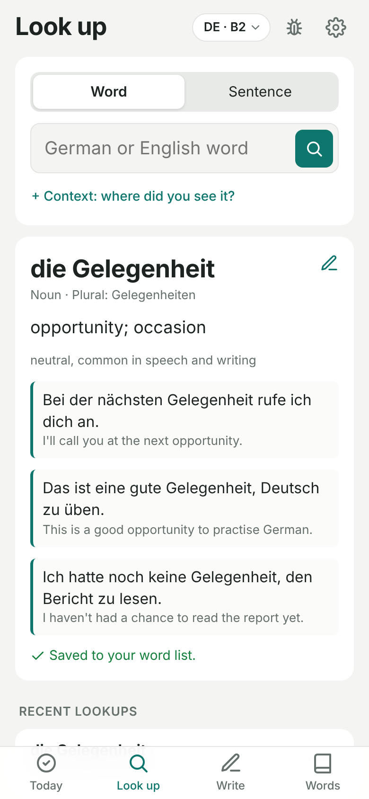
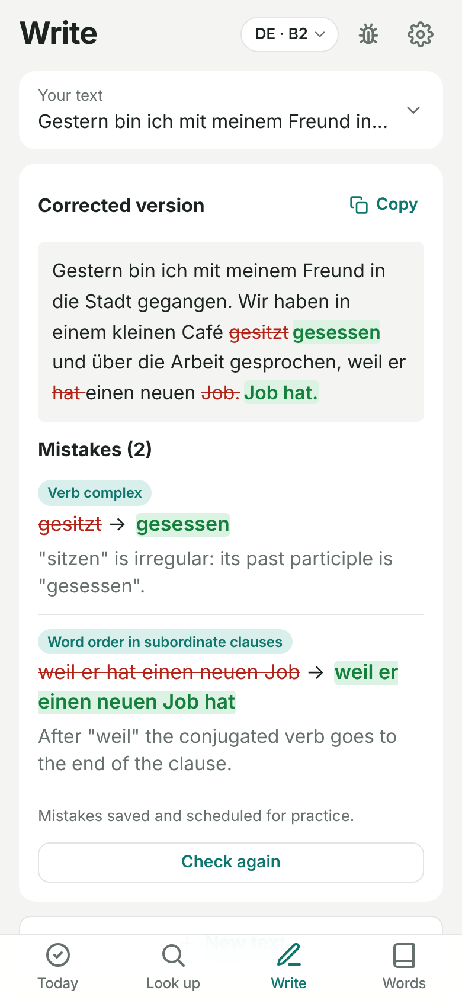
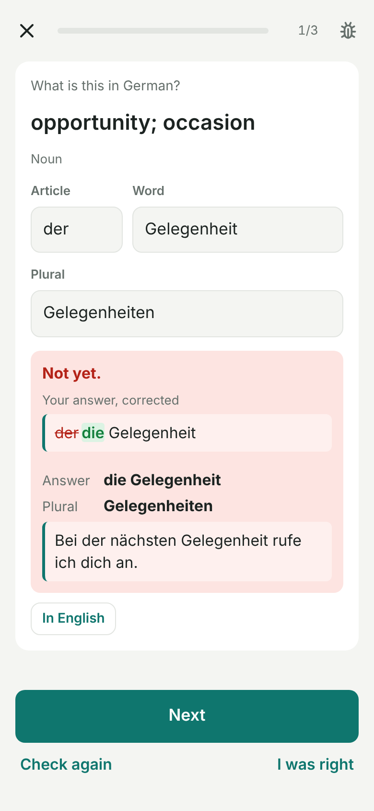
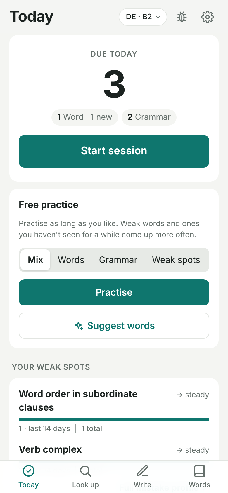

# Language Trainer 🇩🇪 🇯🇵

**Turn the words you look up and the mistakes you make into daily practice, in German, Japanese or any other language.**

Language Trainer is for learners who understand a language better than they can *speak or write* it. It is a
dictionary, a writing corrector and a daily trainer in one. Every word you look up and every mistake you make
comes back as an exercise until you can produce it correctly yourself.

👉 **Open the app: [ravjot-sk.github.io/german-trainer](https://ravjot-sk.github.io/german-trainer/)**

The app started as a German trainer, which is why the link says *german-trainer*. It now works for any language.
Its buttons and explanations are in German at first; you can switch them to English (step 2 below).

<table>
  <tr>
    <td></td>
    <td></td>
    <td></td>
    <td></td>
  </tr>
  <tr>
    <td align="center">Look up</td>
    <td align="center">Write</td>
    <td align="center">Practise</td>
    <td align="center">Track</td>
  </tr>
</table>

---

## What you need

- **An iPhone**, Android phone or computer with a web browser. Nothing to download from an app store.
- **A Google account**, to get a free Gemini key (step 4). Gemini is Google's AI, and it does the lookups,
  corrections and exercises.
- **An invite code** only if you want to sign in and sync your words between devices (step 5). Ask Ravjot
  for one. You can use the app without it.

## Set it up

### Step 1: Put the app on your home screen

**iPhone**

1. Open the [app link](https://ravjot-sk.github.io/german-trainer/) in **Safari**.
2. Tap the **Share** button (the square with an arrow pointing up). On some iPhones you first tap **⋯** at
   the bottom right to find it.
3. Scroll down and tap **Add to Home Screen** (on a German iPhone: **Zum Home-Bildschirm**), then **Add**.
4. Open the app from its new icon. It now runs full-screen, like a normal app.

**Android**

1. Open the [app link](https://ravjot-sk.github.io/german-trainer/) in **Chrome**.
2. Tap the **⋮** menu (top right), then **Add to Home screen** or **Install app**.

**Computer:** just open the link in any browser and bookmark it.

### Step 2: Switch the app to English (optional)

Tap the ⚙️ gear (top right). Under **App**, find **Sprache der App** and tap **English**. The steps below
give the German name first and the English name in brackets.

### Step 3: Choose your language and level

The first time you open the app, it asks **Welche Sprache lernst du?** (Which language are you learning?) and
**Wie gut ist dein …?** (How good is your …?). Pick your language and your level: A1 (beginner) to C2 (near
native), or JLPT N5 to N1 for Japanese. Every exercise, example and explanation is pitched at that level.
You can change it any time in Settings.

German and Japanese are built in. For any other language, choose **+ Andere Sprache …** (+ Another language)
and type its name, for example *Spanish*. More on this in [Languages](#languages) below.

### Step 4: Get a free Gemini key and add it

The app talks to Gemini with your own personal key. It is free; you don't need to enter a credit card.

1. Go to [aistudio.google.com/apikey](https://aistudio.google.com/apikey) and sign in with your Google account.
   The first time, accept the terms.
2. Tap **Create API key**. If it asks for a project, pick the one it suggests.
3. Tap the copy icon next to the long key that appears (it starts with *AIza*).
4. In the app, tap the ⚙️ gear and paste the key into **Gemini-API-Schlüssel** (Gemini API key). Tap
   **Anzeigen** (Show) if you want to check it pasted completely.
5. Tap **Schlüssel testen** (Test key). A green message such as *Funktioniert mit …* (Works with …) means
   you're ready.

**Good to know about the key**

- **Cost:** the free plan allows a limited number of requests per day, which is plenty for normal personal use.
  If you reach it, the app says the daily limit is reached and it works again the next day.
- **Privacy:** the key stays on your device; the app only sends it to Google with each request. The words and
  texts you look up or have corrected go to Google's Gemini. On the free plan Google may use what you send to
  improve its products, so don't paste anything private.
- **Keep it to yourself:** anyone with your key can use your free allowance. If it leaks, delete it in
  AI Studio and create a new one.

### Step 5: Create an account to sync (optional)

Without an account, everything stays on this one device. With an account, your words, mistakes and progress
are the same on all your devices, and they are safe if you lose your phone.

1. Ask Ravjot for an **invite code**.
2. Tap the ⚙️ gear. Under **Konto & Synchronisierung** (Account & sync), enter your email and a password of at
   least 6 characters, and the code under **Einladungscode** (Invite code). Tap **Konto erstellen**
   (Create account).
3. You get an email with a confirmation link. Open it (check your spam folder if it isn't there), then come
   back to the app and tap **Ich habe bestätigt** (I have confirmed). Syncing starts.
4. On your other devices, set up steps 1 to 4, then tap **Anmelden** (Sign in) with the same email and password.

- *Forgot your password?* Tap **Passwort vergessen?** (Forgot password?) and follow the email.
- *"Not invited yet"?* Enter a code there and tap **Code einlösen** (Use code), or ask Ravjot to invite you and
  then tap **Erneut prüfen** (Check again).
- Your Gemini key is never synced; add it on each device.

---

## Using it every day

- **During the day:** look up words when you meet them (**Suchen**), and paste in texts you've written to get
  them corrected (**Schreiben**). Every word and mistake is saved automatically.
- **Once a day:** open **Heute** (Today) and tap **Sitzung starten** (Start session). It takes about 10 minutes.
  Want more? **Üben** (Practise) on the same screen goes on as long as you like.

### Languages

- You can learn several languages. Words, mistakes and progress are kept separate for each one. Switch with the
  language pill at the top (for example **DE · B2**) or in Settings.
- **German and Japanese** each have a fixed list of grammar areas based on research into learners' mistakes
  (German on the MERLIN learner corpus, Japanese on the NAIST Goyo Corpus).
- **Other languages** are set up once by Gemini. Because their list of grammar areas is generated, the app
  notes that it may be incomplete.
- **Japanese:** type with the iPhone Japanese keyboard; lookups also accept romaji. Words are saved with their
  kana reading, and in recall the kanji form is correct while typing only the reading counts as *almost*.
  Furigana (readings above the kanji) appear when you tap the text; change this in **Settings › Furigana**
  (*Tap*, *Always* or *Off*).

---

## Problems and questions

**"Bitte zuerst den Gemini-Schlüssel eintragen"** (Please add your Gemini key first): do step 4.

**"Gemini-Fehler: …"** (Gemini error): tap the ⚙️ gear, then **Schlüssel testen** (Test key). If it says the
key is not valid, copy it again from AI Studio. If the model isn't found, open **Erweitert** (Advanced) and pick
another model from the list.

**"Gemini ist gerade ausgelastet"** (Gemini is busy) or nothing happens for a while: Google is busy. Tap
**Abbrechen** (Cancel) or **Nochmal versuchen** (Try again). What you typed stays.

**"Das Tageslimit … ist erreicht"** (daily limit reached): your free allowance is used up for today. Recall, gap
fill and word order exercises still work; everything else works again tomorrow.

**No internet?** Recall, gap fill and word order work offline. Lookups, corrections and exercises that need
Gemini wait until you're back online.

**A bar says "Neue Version, tippen zum Laden"** (New version, tap to load): an update is ready. Tap it, or it is
used the next time you open the app. A practice session you are in the middle of is kept.

**Where is my data?** On your device, inside the app. If you are signed in, it is also kept in your private
account, which only you can read.

**How do I not lose my data?**
- If you're signed in, your account is your backup.
- If you're not signed in, your data lives only on this phone. Deleting the app from your home screen or
  clearing Safari's website data deletes it. Save a backup now and then: ⚙️ → **Sicherung** (Backup) →
  **Exportieren** (Export). **Importieren** (Import) brings it back.
- **Abmelden** (Sign out) removes your data from that device; it stays in your account. If the app warns that
  changes haven't been uploaded yet, wait until you're online before signing out.

**Found a bug?** Tap the bug icon at the top (during practice it's in the top bar of the session), describe what
went wrong and tap **Senden** (Send). Leave **Bildschirm mitsenden** (Include the screen) ticked so the report
includes what was on screen. Reports become public issues in this repository, without your name or email. You
need to be signed in to send one.

---

## What each screen does, in detail

The tabs at the bottom are **Heute** (Today), **Suchen** (Look up), **Schreiben** (Write) and **Wörter**
(Words). In German, the Suchen and Schreiben screens are titled **Nachschlagen** and **Korrigieren**.

### 🔍 Suchen (Look up)

Type a word in the language you're learning, or an English word to find it. Gemini gives you the meaning,
article, plural or key forms (the reading for Japanese), a note on register, and an example sentence.

- **Every lookup is saved to your word list automatically.** There's no extra step.
- Tap **+ Kontext** to add the sentence where you found the word. The app picks the right meaning for
  that sentence, and later turns the sentence into a gap-fill exercise.

**Whole sentences.** Switch to **Satz** to translate a sentence (typed in English or in the language you're
learning) and pick a tone:

| Tone | When to use it |
|---|---|
| Alltag (everyday) | How people really talk day to day. This is the default. |
| Förmlich (formal) | Polite and professional: officials, work, people you don't know (Sie, keigo) |
| Informell (informal) | Casual, with friends and family (du, plain form) |

You get the translation, a one-line note on what makes it sound that way, and the useful words in it. Tap
a word to save it too. The sentence is saved automatically and joins your daily practice.

### ✏️ Schreiben (Write)

Paste or write anything in the language you're learning: an email, a chat message, a practice paragraph.
You get back:

- the corrected text, with every change highlighted,
- each mistake with a short explanation, a grammar category such as *Adjektivendungen* in German or
  *Particles* in Japanese, and the specific **rule** it breaks, such as *Perfekt mit sein bei Zustandswechsel*.

Every mistake is saved to your profile, and its rule is scheduled for practice. If you picked the wrong word, the right
word goes into your word list too. Tap **Kopieren** to copy the corrected text.

If your text is correct but could sound more natural, you also see **Natürlicher klingt es so** with a better
phrasing and why. That's a suggestion, not a mistake. Tap **Zum Üben speichern** to add it to your sentences.

After a correction the result comes first and your text folds into one line; tap it to edit and correct again,
or tap **Neuer Text** to start over.

### ✅ Heute (Today) and how practice works

Shows what's due today and your three weakest grammar areas (tap **Ganzes Fehlerprofil** for the full
profile, see below). Your daily session mixes vocabulary and grammar. The app decides what's due using spaced repetition: things
you get right come back after longer and longer gaps, and things you get wrong come back tomorrow.

**Vocabulary.** Every exercise asks you to *produce* the language, not just recognise it. Each word moves through
three stages:

| Stage | What you do |
|---|---|
| Recall | See the meaning and type the word: for German nouns with article and plural, for Japanese in kanji |
| Gap fill | Fill the word into a sentence: first the one where you found it, then new ones |
| Write | Write your own sentence with the word, and Gemini checks it |

**Gap sentences change.** Each word keeps a small set of gap sentences. Get one right and you won't see it
again for that word; get it wrong and the same sentence comes back next time. They get harder as you learn the
word (another form or tense, then longer sentences). They come from the lookup's examples and from your own
sentences in the Write exercise once corrected. When a word coming up soon runs low, Gemini writes new ones for up to ten words
in one go, in the background when a session starts.

**Sentences.** Saved sentences rotate through three exercises:

| Exercise | What you do |
|---|---|
| Say it | See the English and the tone, and write the sentence. Gemini checks it, so any correct phrasing counts. Using a different tone is never a mistake: you only get a tip on how it's usually said. |
| Put it in order | Tap the shuffled pieces back into the right order (works offline) |
| Fill the gap | Fill in the sentence's key expression |

After "write a sentence" and "say it", you may also see a more natural phrasing that you can save.

**Buttons on every exercise.**

- **Weiß ich nicht** (I don't know) shows the answer. It counts as a wrong answer, so the item comes back, but
  nothing goes into your mistake profile. **Überspringen** (Skip) moves on without saving anything.
- **Auf Englisch** (In English) appears once you've answered. It shows the English of the sentences in the
  exercise. Translations Gemini adds for gap sentences and examples are saved with the word.
- **Nochmal prüfen** (Check again) appears with the result when Gemini is set up. If a verdict looks wrong, Gemini
  checks the same answer once more, and its new verdict replaces the first. Mistakes are only saved when you tap
  **Weiter** (Next), so a mistake the second check takes back never reaches your profile. **Korrigieren** has the
  same button: there the second check replaces the first one's mistakes in your profile.

**Grammar.** This comes from your own mistakes. You practise the **rule** behind a mistake, in new sentences
each time, never by re-fixing the old sentence. Each rule climbs a ladder of five steps:

| Step | Exercise | What you do |
|---|---|---|
| 1 | Erkennen | Two versions of a sentence: pick the right one |
| 2 | Wählen | Fill the gap exactly where the rule decides (*Was ___ passiert?*) |
| 3 | Umformen | Change three short sentences, each with a different verb or noun |
| 4 | Finden | A short text has mistakes against the rule: correct them |
| 5 | Schreiben | Write a new sentence that needs the rule |

New rules start at step 2. A right answer moves the rule up a step, a wrong one moves it down. Passing step 5
on two different days marks it as mastered (*Sitzt*). Making the same mistake again in your writing moves the
rule back down and brings it up again. A rule you just broke while writing comes up again a few exercises later.
Mistakes in categories without rules yet get general drills for that category.

Tips:
- If you were right but typed it slightly differently, tap **Ich lag richtig** to count it as correct.
- New words and rules join your session **the same day** you add them. You get at most 8 new words a day by default,
  and you can change this in Settings. New sentences have their own limit of 3 a day.
- Words and old sentences you get wrong come back once more at the end of the session.

**Freies Üben (Free practice).** Below the daily session on **Heute**, tap **Üben** to practise as long as you
like, even when nothing is due. It goes in rounds: each round brings up everything in your focus once, and
words and grammar you got wrong recently, have missed often or haven't seen for a while tend to come earlier.
Choose a focus first if you want: **Gemischt** (mix), **Wörter**, **Sätze**, **Grammatik** or
**Schwächen** (weak spots). The top shows how many you got right; tap ✕ to stop.

- A right answer counts as a success: the word's next exercises get harder (recall, gap, writing, and harder
  gap sentences), but its date for the daily session stays where it is.
- A wrong answer counts too: the word comes back a few tasks later and in tomorrow's session.
- After each round you can mix in saved words you haven't started yet (beyond the daily limit, up to that many
  per round), get suggested words, or go round again.

### 📖 Wörter (Words)

All your saved words and sentences, with a filter to show only one kind. Search them, tap one to edit any field, or delete words you don't want to practise.
Tap **+** to add a word by hand. Rarely needed fields (register, example, gap sentence) are under **Mehr Felder**.

**Wörter vorschlagen (Suggest words).** Tap ✨ (also on **Heute** while your list is short) and Gemini suggests
8 words that fit your level, leaving out words you already have. Add a topic such as *Arbeit* to steer it. All
suggestions are ticked; untick the ones you don't want and tap **Hinzufügen**. They join your list like a
lookup and come up in your sessions.

### 📊 Fehlerprofil (Profile)

Open it from **Heute** → **Ganzes Fehlerprofil**. See which grammar areas trip you up most. For each category you see:

- how often it came up in the **last 14 days**,
- whether it is **improving** (wird besser) or coming up **more often** (häufiger),
- your score in drills for that category,
- the **rules** under it, each marked *Neu*, *Wackelig* (being practised) or *Sitzt* (mastered). Tap a rule
  to see what it says and the mistakes you made against it.

Mistakes saved before rules existed are sorted into the current categories and given their rule in the
background the first time you open the profile (needs Gemini).

---

## Settings

Tap the ⚙️ gear (top right).

| Setting | What it does |
|---|---|
| Ich lerne / Mein Niveau (Learning / My level) | The language you're practising and your level in it; add another language here |
| Neue Wörter pro Tag (New words per day) | How many new words join your session each day |
| Konto & Synchronisierung (Account & sync) | Sign in to keep your data the same on all your devices (step 5) |
| Gemini-API-Schlüssel (Gemini API key) | Your key (step 4) |
| Erweitert (Advanced) → Gemini-Modell | Which Gemini model to use. **gemini-flash-lite-latest** is the recommended default |
| Sprache der App (App language) | Switch the app's buttons and explanations between German and English |
| Sicherung (Backup) | Export your data to a file, or import it again |

---

## For the app owner and developers

- [docs/SETUP.md](docs/SETUP.md): one-time setup of Firebase (accounts and sync), admin access, invite codes
  and bug reports.
- [docs/DEVELOPING.md](docs/DEVELOPING.md): running the app locally, tests, how the code is organised, and
  how it is published.

## License

Copyright (C) 2026 ravjot-sk

This program is free software: you can redistribute it and/or modify it under the terms of the GNU General
Public License as published by the Free Software Foundation, either version 3 of the License, or (at your
option) any later version. See [LICENSE](LICENSE) for the full text.
